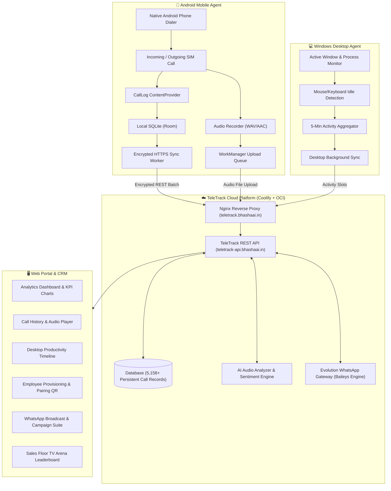

# 📞 TeleTrack — Enterprise SIM Call Analytics, Desktop Productivity & AI Telecalling SaaS

[](LICENSE)
[](https://teletrack.bhashaai.in)
[](https://ashokmallickone.bhashaai.in)
[](https://github.com/evolution-foundation/evolution-api)

> **GitHub Repository**: [https://github.com/ashokmallick1/teletrack](https://github.com/ashokmallick1/teletrack)  
> **Production Web App**: [https://teletrack.bhashaai.in](https://teletrack.bhashaai.in)  
> **Production API Server**: [https://teletrack-api.bhashaai.in](https://teletrack-api.bhashaai.in)  
> **Coolify Platform Console**: [https://ashokmallickone.bhashaai.in](https://ashokmallickone.bhashaai.in)  
> **Evolution WhatsApp Engine**: [https://github.com/evolution-foundation/evolution-api](https://github.com/evolution-foundation/evolution-api)

---

## 1. 📖 Product Description

**TeleTrack** is a unified, enterprise-grade telecalling management, call analytics, and employee productivity platform. Designed for organizations with field agents, inside-sales teams, customer support representatives, and distributed workforces, TeleTrack bridges the gap between **SIM-based mobile calling**, **desktop workstation activity**, and **automated customer engagement**.

### The Problem It Solves
Traditional telecalling teams face multiple blind spots:
1. **Untracked SIM Calls**: Most sales agents use native SIM cards on company or personal Android phones. Managers have zero visibility into actual call volumes, talk time, connection rates, or customer conversations.
2. **Lack of Conversation Intelligence**: Without call recordings and transcription, customer sentiment, objection handling, and compliance breaches cannot be audited.
3. **Disjointed Workstation Tracking**: Remote or in-office agents spend time across web browsers, ERPs, and spreadsheets, but managers cannot measure active vs. idle time or desktop application productivity.
4. **Manual Follow-ups & CRM Friction**: Telecallers waste hours manually drafting WhatsApp messages or logging lead statuses.

### The TeleTrack Solution
TeleTrack continuously synchronizes call logs from native Android dialers, records conversations for automated AI quality audits, monitors workstation active/idle slots from a lightweight Windows desktop client, and integrates with WhatsApp via an embedded Evolution API gateway — all managed from a centralized multi-tenant web cloud.

---

## 2. 🎯 What TeleTrack Is Supposed To Do



### Key Capabilities & Workflows

#### 1. 📱 Native Android Telematics Agent (`apps/android`)
- **Native SIM Telephony**: Agents make and receive calls using their phone's native SIM dialer (Samsung, Xiaomi, Vivo, etc.) without requiring VoIP, SIP trunks, or changing the dialing experience.
- **Background Call Log Harvesting**: Captures timestamp, duration, direction (Inbound, Outbound, Missed, Rejected), and SIM slot index.
- **Call Recording & Auto-Upload**: Captures call audio via authorized audio APIs and uploads the recording file in the background directly to the TeleTrack server.
- **Offline Resiliency**: Employs Room SQLite database (`queued_call_events`) and Android `WorkManager` with exponential retry policies. Calls are queued offline and automatically synced once an internet connection is restored.
- **Fleet Diagnostics**: Reports battery level, connectivity type (Wi-Fi/5G), app version, and sync health to alert managers if an agent turns off background permissions.

#### 2. 💻 Windows Workstation Productivity Agent (`apps/desktop`)
- **Active Application Tracking**: Records active window titles and executable names (e.g. Chrome, Excel, CRM, VS Code, Idle) in 5-minute telemetry slots.
- **Idle Detection**: Uses native Win32 APIs (`GetLastInputInfo`) to track mouse/keyboard inactivity, separating focused work from away-from-keyboard time.
- **Productivity Categorization**: Classifies application usage into Productive, Neutral, or Unproductive categories with daily score cards.
- **Offline Slot Caching**: Stores activity slots locally if disconnected and syncs in batches to `/api/v1/desktop/activity`.

#### 3. 🤖 AI Audio Analyzer & Sentiment Intelligence (`services/api`)
- **Automated Audio Transcription**: Converts uploaded call recordings into timestamped text transcripts.
- **Executive Summaries**: Produces a 3-bullet summary of every customer interaction.
- **Sentiment & Objection Scoring**: Rates customer sentiment (`POSITIVE`, `NEUTRAL`, `NEGATIVE`) and telecaller professionalism (`1-100`).
- **In-Browser Audio Player**: Managers can play recordings directly inside the web portal with interactive waveform seeking, playback speed control (1x, 1.5x, 2x), and transcript view.

#### 4. 💬 WhatsApp Integration via Evolution API (`services/api` + OCI)
- **WhatsApp Web Pairing**: Integrates with [Evolution API](https://github.com/evolution-foundation/evolution-api) (v2.3.7) to pair any corporate WhatsApp number via QR code.
- **Instant Post-Call Follow-ups**: Telecallers can click a single button to dispatch WhatsApp messages, brochures, or payment links to dialed leads.
- **Broadcast Calling Campaigns**: Bulk outreach campaigns with variable templating (`{{name}}`, `{{company}}`).
- **Automated Webhooks**: Receives incoming message updates, delivery receipts, and connection state changes.

#### 5. 📊 Centralized Multi-Tenant SaaS Web Portal (`apps/web`)
- **KPI Dashboards**: Total calls, total connected hours, answer ratios, first-call resolution, and volume trends over time.
- **Customer Privacy Masking**: Optional phone number masking (`+91 98**** 1234`) to protect sensitive customer leads.
- **Employee & Multi-Device Provisioning**: Admins create users with custom user IDs, passwords, and roles (`ORG_OWNER`, `ORG_ADMIN`, `MANAGER`, `EMPLOYEE`). The portal generates:
  - Android login credentials and instant pairing QR codes.
  - Windows desktop sync tokens for instant one-click agent workstation setup.
- **Full-Screen Sales Floor Arena (`/tv-leaderboard`)**: Real-time sales floor TV leaderboard displaying top telecallers, connected duration rankings, deals closed, and live celebration banners.

---

## 3. 🏗️ Repository Architecture

```
teletrack/
├── apps/
│   ├── web/                     # React 18 + Vite + Tailwind CSS + Recharts SaaS Portal
│   ├── android/                 # Kotlin + Jetpack Compose + Room + WorkManager Native Agent
│   └── desktop/                 # Electron / Node.js Windows Activity & Productivity Agent
├── services/
│   └── api/                     # Node.js + Express REST API (v1) with memory/Postgres DB
├── packages/
│   ├── shared-types/            # Canonical TypeScript entity interfaces and DTOs
│   └── api-client/              # Typed TypeScript HTTP SDK for all API endpoints
├── database/
│   ├── migrations/              # PostgreSQL DDL migrations with Row Level Security (RLS)
│   └── seed/                    # Demo seed data (5,158+ call records, devices, leads)
├── docs/                        # Complete technical and compliance guides
├── Dockerfile.api               # Optimized ARM64/AMD64 Dockerfile for backend API
├── Dockerfile.web               # Nginx Alpine reverse-proxy Dockerfile for web frontend
├── nginx.conf                   # Single-origin SPA routing & API reverse proxy configuration
├── docker-compose.yml           # Local multi-container Docker Compose definition
├── deploy-coolify-service.cjs   # Automated Coolify Service deployment script
├── test-cloudflare-suite.cjs    # Playwright end-to-end Cloudflare verification suite
└── README.md                    # Project documentation
```

---

## 4. 🚀 Quickstart & Local Development

### 4.1 Install Monorepo Dependencies
```bash
npm install
```

### 4.2 Build Packages & Applications
```bash
npm run build --workspaces --if-present
```

### 4.3 Run Services Locally
```bash
# Terminal 1: Run Backend API (Port 4000/4100)
npm run dev --workspace=services/api

# Terminal 2: Run Web Portal (Port 3000/3100)
npm run dev --workspace=apps/web
```

#### Default Seed Credentials:
| Account | Email | Password | Role |
| :--- | :--- | :--- | :--- |
| **Organization Owner** | `owner@acme.com` | `Password123!` | Full Admin / Owner |
| **Sales Manager** | `manager@acme.com` | `Password123!` | Team Manager |
| **Field Telecaller (Rahul)**| `rahul@acme.com` | `Password123!` | Employee / Telecaller |
| **Super Admin** | `superadmin@teletrack.io` | `Password123!` | Universal Platform Admin |

---

## 5. 🌐 Deployment on Oracle Cloud (OCI) & Coolify

The application is deployed on Oracle Cloud Infrastructure ARM64 (`aarch64` / 4 OCPU / 24 GB RAM) managed by **Coolify**:

```bash
# Deploy / update service in Coolify
node deploy-coolify-service.cjs
```

The Coolify stack runs 5 unified containers:
1. `teletrack-web`: Nginx reverse proxy serving the React SPA and routing `/api/`
2. `teletrack-api`: Node.js backend with persistent database (5,158+ records)
3. `teletrack-evolution-api`: Evolution API WhatsApp gateway (Baileys)
4. `teletrack-evolution-db`: Dedicated PostgreSQL database for WhatsApp sessions
5. `teletrack-tunnel`: Cloudflare tunnel exposing public subdomains

---

## 6. 🧪 End-to-End Playwright Testing

To verify all Cloudflare tunnel endpoints, authentication, dashboard charts, call records, WhatsApp settings, and binary downloads:

```bash
node test-cloudflare-suite.cjs
```

---

## 7. 📤 Pushing to Your GitHub Repository

To link and push your local repository to GitHub:

```bash
# 1. Add your GitHub remote
git remote add origin https://github.com/ashokmallick1/teletrack.git

# 2. Stage all files
git add .

# 3. Commit changes
git commit -m "feat: complete TeleTrack platform with Android, Desktop, AI and WhatsApp integration"

# 4. Push to main branch
git branch -M main
git push -u origin main
```
*(Make sure the repository `teletrack` is created under your GitHub account `ashokmallick1` before pushing).*
